# 작업 1 — scRNA-seq 분석 (10x PBMC3k)

건강한 공여자의 말초혈액 단핵세포(PBMC) 약 2,700개를 Scanpy로 분석해
QC → 정규화 → 클러스터링 → 세포타입 annotation까지 수행한다.

- 데이터: 10x Genomics 공개 PBMC3k (Chromium v1, Cell Ranger filtered matrix). `sc.datasets.pbmc3k()`로 자동 다운로드
- 환경: Python 3.12, scanpy 1.12, anndata 0.13, gseapy 1.3
- 실행: 프로젝트 루트에서 `step1` → `step4` 스크립트를 순서대로 실행 (각 단계가 `data/`에 h5ad를 저장하고 다음 단계가 읽는다)

| 단계 | 스크립트 | 상태 |
|---|---|---|
| 1. QC → 정규화 → HVG | `step1_qc_norm_hvg.py` | 완료 |
| 2. PCA → 이웃그래프 → Leiden → UMAP | `step2_pca_cluster_umap.py` | 완료 |
| 3. 마커 유전자 기반 세포타입 annotation | `step3_annotation.py` | 완료 |
| 4. 차등발현 / 경로분석 (CD14+ vs FCGR3A+ 단핵구) | `step4_de_pathway.py` | 완료 |

---

## 1단계. QC → 정규화 → HVG 선택

### 1-1. QC: 품질이 나쁜 세포 걸러내기

droplet 기반 scRNA-seq에서 바코드 하나가 항상 "건강한 세포 1개"인 것은 아니다.
이 데이터는 Cell Ranger가 빈 droplet을 이미 제거한 filtered matrix이므로,
여기서는 **손상된 세포**와 **doublet 의심 세포**를 제거하는 것이 목적이다.

| 지표 | 의미 | 기준 | 생물학적/기술적 근거 |
|---|---|---|---|
| `n_genes_by_counts` 하한 | 세포당 검출 유전자 수 | ≥ 200 | 너무 적으면 빈 droplet·세포 파편 |
| `n_genes_by_counts` 상한 | 〃 | < 2,500 | 세포 2개가 한 droplet에 들어간 doublet은 유전자 수·UMI가 함께 비정상적으로 높다 |
| `pct_counts_mt` | 총 UMI 중 미토콘드리아 유전자(`MT-`) 비율 | < 5% | 세포막이 손상되면 세포질 mRNA는 유출되고, 막으로 싸인 미토콘드리아 전사체만 남아 비율이 상승 → 사멸/손상 세포 지표 |
| 유전자 `min_cells` | 유전자가 검출된 세포 수 | ≥ 3 | 1~2개 세포에서만 잡힌 유전자는 통계적으로 쓸 수 없음 |

**결과**

| 단계 | 세포 | 유전자 |
|---|---|---|
| 원본 | 2,700 | 32,738 |
| min_genes ≥ 200, min_cells ≥ 3 | 2,700 | 13,714 |
| n_genes < 2,500 | 2,695 (−5) | 13,714 |
| pct_mt < 5% | **2,638** (−57) | **13,714** |

- 필터 전 중앙값: 유전자 817개/세포, UMI 2,197개/세포, 미토콘드리아 2.0%
- 유전자의 58%(19,024개)가 3개 미만 세포에서만 검출돼 제거됨 — 혈액세포에서 거의 발현되지 않는 유전자(다른 조직 특이 유전자 등)로 해석
- 총 62개 세포(2.3%) 제거

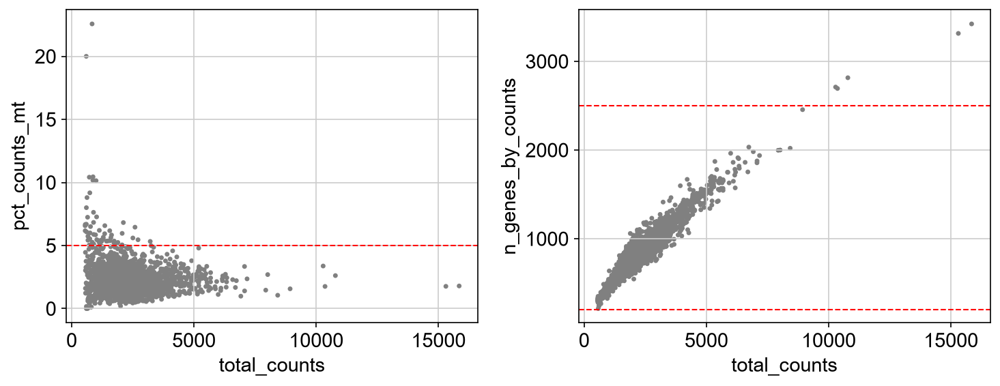

왼쪽: UMI가 적으면서 미토콘드리아 비율만 높은 세포들(좌상단)이 손상 세포의 전형적 모습.
오른쪽: UMI 수와 유전자 수는 거의 선형 관계이며, 우상단으로 동떨어진 5개가 doublet 의심 세포.

> **한계**: 임계값(2,500 / 5%)은 PBMC·10x v1 화학에 맞춘 경험적 값이다.
> 심근세포처럼 미토콘드리아가 원래 많은 조직, 유전자 검출 수가 훨씬 많은 최신 v3 화학에서는
> 같은 숫자를 쓰면 안 되고, 분포를 보고(예: MAD 기반) 다시 정해야 한다.
> 유전자 수 상한은 doublet의 거친 근사일 뿐이며, 정식으로는 Scrublet·scDblFinder 같은 전용 도구를 쓴다.

### 1-2. 정규화

1. **Library size 정규화 (CP10K)** — 세포마다 총 UMI 수가 548~15,844로 크게 다르다.
   이 차이의 대부분은 포획 효율·시퀀싱 깊이 같은 기술적 요인이므로, 세포별 총합을 10,000으로 맞춘다.
2. **log1p 변환** — count 데이터는 평균이 클수록 분산도 커서 소수의 고발현 유전자가 세포 간 거리를 지배한다.
   `log(1+x)`로 분산을 안정화하고 차이를 fold-change 스케일로 본다.

raw count는 `adata.layers["counts"]`에 보존했다.

### 1-3. HVG (Highly Variable Genes) 선택

13,714개 유전자 대부분은 모든 세포에서 비슷하게 발현되거나(housekeeping) 거의 0이어서 세포타입 구분에 정보를 주지 않는다.
평균 발현량이 비슷한 유전자끼리 비교했을 때 세포 간 변동이 유독 큰 유전자만 골라 차원축소·클러스터링에 사용한다.

- 방법: `flavor="seurat"` (평균 발현 구간별 dispersion z-score), `min_mean=0.0125, max_mean=3, min_disp=0.5`
- 결과: **1,838개** 선택 (13.4%)
- 유전자를 잘라내지 않고 플래그만 남김 → PCA는 HVG만, 마커 확인·차등발현은 전체 유전자 사용

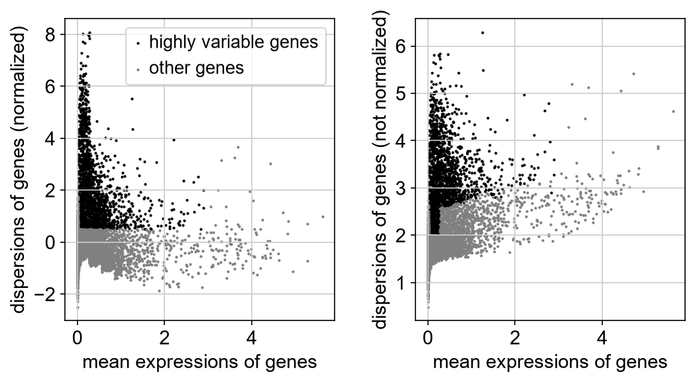

### 산출물

- `data/pbmc3k_step1_qc_norm_hvg.h5ad` — 2,638 cells × 13,714 genes (X: log-normalized, layers["counts"]: raw)
- `figures/01~04_*.png`

---

## 2단계. PCA → 이웃그래프 → Leiden 클러스터링 → UMAP

유전자 13,714개를 그대로 쓰면 세포 간 거리가 노이즈에 묻힌다.
HVG → PCA로 압축한 공간에서 비슷한 세포끼리 연결한 **kNN 그래프**를 만들고,
그 그래프에서 클러스터(Leiden)와 2D 지도(UMAP)를 각각 얻는다.

```
log-normalized (HVG 1,838개) → scale → PCA(50) → 상위 10 PC → kNN 그래프(k=10) ─┬─ Leiden  (클러스터 = 분석 결과)
                                                                              └─ UMAP    (2D 그림 = 시각화)
```

> Leiden과 UMAP은 같은 그래프에서 나온 형제 결과다. UMAP 그림을 보고 클러스터를 나눈 것이 아니며,
> UMAP에서 덩어리 사이의 거리나 덩어리 크기는 해석하지 않는다.

### 2-1. 스케일링과 PCA

- **스케일링**(유전자별 평균 0, 분산 1, 최대 10으로 clip): 하지 않으면 발현량 자체가 큰 유전자가 PC를 지배한다.
  log-normalized 값은 `layers["lognorm"]`에 보존해 마커 확인·차등발현에 쓴다.
- **PCA**: 서로 함께 움직이는 유전자 묶음(= 세포타입 프로그램)을 소수의 축으로 요약한다.

상위 PC를 끌고 가는 유전자를 보면 각 축이 이미 혈액세포 계통을 구분하고 있다.

| PC | (+) 방향 | (−) 방향 | 해석 |
|---|---|---|---|
| PC1 | CST3, TYROBP, LST1, AIF1, FCN1 | PTPRCAP, IL32, LTB, CD2, CD247 | 골수계(myeloid) ↔ 림프계(lymphoid) |
| PC2 | NKG7, GZMB, PRF1, GZMA | CD79A, MS4A1, TCL1A, HLA-DQ | 세포독성(NK/CD8 T) ↔ B세포 |
| PC3 | PPBP, PF4, GNG11, SPARC | HLA-DP/DR, CD37 | 혈소판 ↔ 그 외 |
| PC4 | CD79A, CD79B, MS4A1 | IL32, AQP3, MAL | B세포 ↔ T세포 |

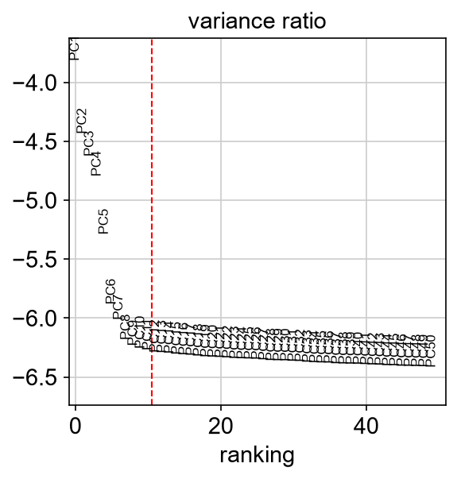

**PC 개수 = 10**: PC별 설명 분산이 PC7~10 부근에서 평탄해진다(elbow). 그 뒤의 PC는 서로 구분되지 않는 노이즈 수준이다.

> 설명 분산이 PC1 2.2%, PC1–10 누적 6.8%로 낮아 보이지만 scRNA-seq에서는 정상이다.
> 유전자 대부분의 변동은 dropout 등 유전자마다 독립적인 기술 노이즈여서 어떤 축으로도 요약되지 않기 때문이다.

### 2-2. 이웃 그래프

상위 10개 PC 공간에서 각 세포의 가장 가까운 10개 세포를 연결했다(`n_neighbors=10`).
k가 작으면 희귀 집단을 살리지만 그래프가 조각나고, 크면 작은 집단이 큰 집단에 흡수된다.

### 2-3. Leiden 클러스터링과 해상도 선택

Leiden은 그래프에서 내부 연결이 촘촘하고 외부 연결이 성긴 커뮤니티를 찾는다.
`resolution`은 정답이 있는 값이 아니라 얼마나 세밀하게 볼지 정하는 손잡이여서 여러 값을 비교했다.

| resolution | 클러스터 수 | 달라지는 점 |
|---|---|---|
| 0.3 | 8 | 큰 림프구 덩어리가 1개(1,141개 세포)로 뭉침 |
| **0.5** | **9** | 그 덩어리가 2개로 나뉨 (512 / 633) |
| 0.8 | 11 | 덩어리가 3개로 더 쪼개짐 + 14개 세포짜리 소집단 분리 |
| 1.0 | 14 | 계속 세분화 |
| 1.5 | 19 | 〃 |

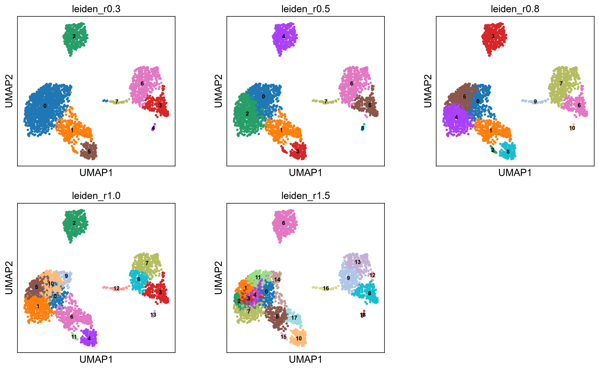

**0.5를 채택한 근거**
- 0.8에서 새로 갈라진 두 클러스터(0번 vs 5번)를 직접 비교하면 유의한 차이 유전자가 SELL, CCR7, MAL, CCL5, S100A4 등 몇 개뿐이고
  각 클러스터를 나머지 전체와 비교했을 때의 상위 유전자는 둘 다 리보솜 유전자다. 뚜렷한 마커 없이 연속적인 상태를 임의로 자른 과분할(over-clustering)로 판단했다.
- 0.5의 2분할은 한쪽이 LTB, IL7R, CD3D, IL32 같은 뚜렷한 상위 유전자를 가진다.
- UMAP에서 따로 떨어진 섬들은 0.3~1.5 어디서나 같은 경계로 유지된다 → 해상도에 민감한 것은 큰 림프구 덩어리 내부뿐이다.

**참고로 남기는 관찰**: 0.8에서 분리되는 14개 세포 소집단은 GNLY, XCL1, XCL2, KLRC1, SELL이 높아 실제 아형일 가능성이 있다.
0.5에서는 이웃한 155개 세포 클러스터에 포함된다. 3단계 annotation에서 다시 확인한다.

### 2-4. UMAP과 품질 점검

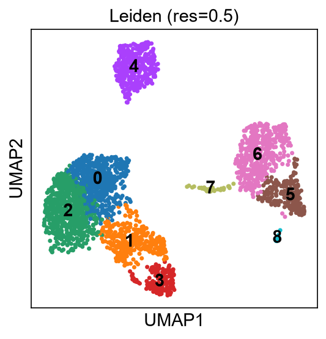

클러스터가 생물학이 아니라 품질 차이로 갈렸는지 확인했다.

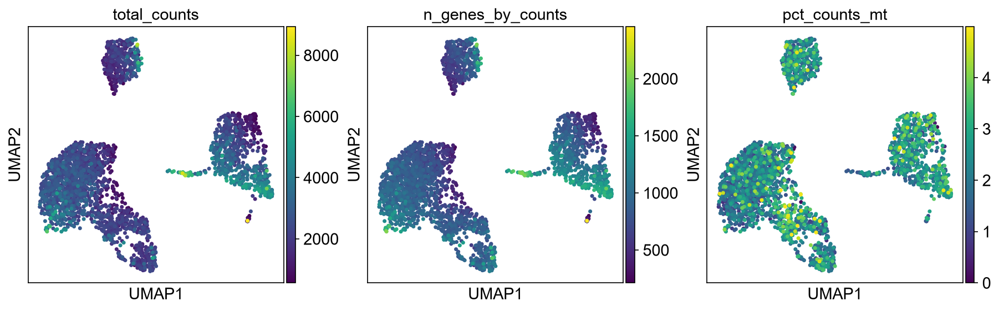

| 클러스터 | 세포 수 | UMI 중앙값 | 유전자 수 중앙값 | MT% 중앙값 |
|---|---|---|---|---|
| 0 | 512 | 2,091 | 719 | 1.89 |
| 1 | 303 | 1,983 | 805 | 2.37 |
| 2 | 633 | 2,546 | 885 | 1.67 |
| 3 | 155 | 1,899 | 888 | 1.94 |
| 4 | 344 | 1,764 | 676 | 2.06 |
| 5 | 205 | 3,756 | 1,243 | 2.37 |
| 6 | 435 | 2,208 | 823 | 2.23 |
| 7 | 38 | 5,297 | 1,570 | 1.82 |
| 8 | 13 | 917 | 350 | 1.57 |

- 미토콘드리아 비율은 모든 클러스터가 1.6~2.4%로 비슷하다 → 손상 세포만 모인 클러스터는 없다.
- 7번은 UMI·유전자 수가 가장 많고 8번은 가장 적다. 저품질 때문인지 세포 자체의 RNA 양 차이인지는 3단계에서 마커로 판단한다.

### 산출물

- `data/pbmc3k_step2_clustered.h5ad` — `obs["leiden"]`(res 0.5), `obsm["X_pca"]`, `obsm["X_umap"]`, `layers["lognorm"]`
- `figures/05~09_*.png`

---

## 3단계. 마커 유전자 기반 세포타입 annotation

두 가지 근거가 일치할 때만 이름을 붙였다.

- **(A) data-driven** — 클러스터별로 나머지 세포 대비 높게 발현되는 유전자를 Wilcoxon rank-sum 검정으로 추출 (`results/cluster_markers_top25.csv`)
- **(B) knowledge-driven** — 면역학에서 알려진 계통 마커가 어느 클러스터에서 켜지는지 확인

> 같은 데이터로 클러스터를 만들고 그 클러스터 간 차이를 검정하므로 p값은 과대평가된다(double dipping).
> p값은 순위용으로만 쓰고, 판단은 log2FC와 발현 세포 비율(클러스터 내 % / 나머지 %)로 했다.

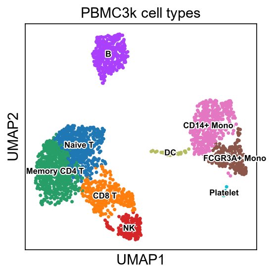
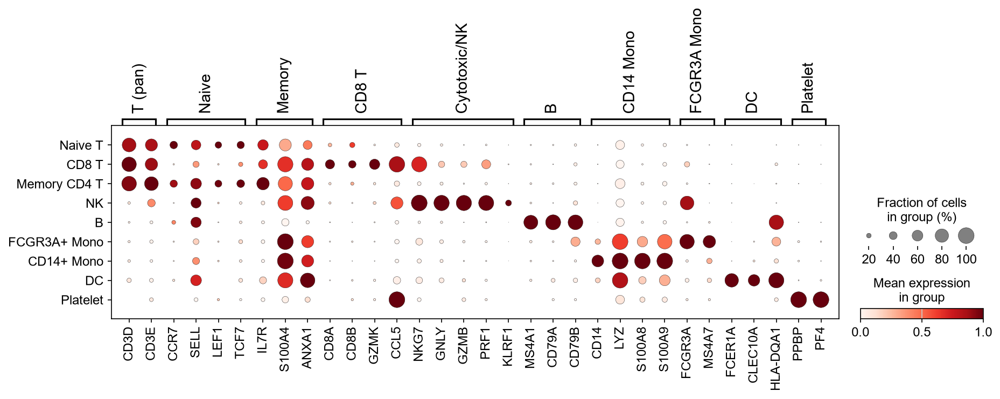

### 3-1. 결과 요약

| 클러스터 | 세포타입 | 세포 수 (%) | 핵심 마커 (클러스터 내 % / 나머지 %) | 확신도 |
|---|---|---|---|---|
| 0 | Naive T | 512 (19.4) | CD3D 84/44, CCR7 38/15, LEF1, SELL | 중 |
| 1 | CD8 T | 303 (11.5) | CCL5 98/23, GZMK 57/5, NKG7 95/21, CD8A/B | 상 |
| 2 | Memory CD4 T | 633 (24.0) | CD3D 91/40, IL7R 73/30, LTB 97/62, S100A4↑ | 중 |
| 3 | NK | 155 (5.9) | GNLY 96/13, GZMB 95/7, PRF1 94/11, CD3D 음성 | 상 |
| 4 | B | 344 (13.0) | CD79A 94/4, MS4A1 85/5, CD79B 92/14 | 상 |
| 5 | FCGR3A+ Mono | 205 (7.8) | FCGR3A 89%, MS4A7 73%, CD14 낮음 | 상 |
| 6 | CD14+ Mono | 435 (16.5) | S100A8 98/14, S100A9 100/23, FCN1 95/17, CD14 68% | 상 |
| 7 | DC | 38 (1.4) | FCER1A 82/1, CLEC10A 66%, MHC-II 최고 | 상 |
| 8 | Platelet | 13 (0.5) | PPBP 100/2, PF4 100/1, GNG11 100/1 | 상 |

림프구(T+NK+B) 약 74%, 단핵구 약 24%, DC 1.4%로 건강한 성인 PBMC의 알려진 구성 범위와 어긋나지 않는다.

### 3-2. 클러스터별 판단 근거

**먼저 큰 계통을 가른다.** PC1이 보여준 대로 골수계(LYZ, CST3, TYROBP)와 림프계(CD3D, IL32, LTB)가 가장 크게 나뉜다.
림프계는 다시 CD3D(T) / CD79A·MS4A1(B) / CD3D 음성 + 세포독성(NK)으로 갈린다.

**4번 — B세포.** CD79A·CD79B는 B세포 수용체(BCR)의 신호전달 단위이고 MS4A1은 CD20이다. 세 유전자 모두 다른 클러스터에서는 5~14%만 발현한다.
MHC class II(HLA-DR/DQ/DP)와 CD74가 높은 것은 B세포가 전문 항원제시세포이기 때문이다.

**3번 — NK세포.** perforin(PRF1)·granzyme B(GZMB)·granulysin(GNLY)이 94% 이상에서 발현하는 세포독성 세포인데 CD3D는 9%뿐이다.
세포독성 프로그램은 있고 TCR 복합체는 없으므로 CD8 T가 아니라 NK다. FCGR3A(CD16, 항체의존성 세포독성 ADCC 수용체)도 83%에서 발현한다.
- CD3E가 39%에서 검출되지만 CD3D(9%)·CD3G(7%)는 B세포·단핵구와 같은 배경 수준이어서 TCR 복합체로 보기 어렵다. NK세포가 CD3ε 전사체를 발현하는 것은 알려진 현상이다.

**1번 — CD8 T세포.** CD3D 89%로 T세포이면서 CD8A/CD8B(MHC-I 인식 공수용체)가 59%에서 검출되고 GZMK·CCL5·NKG7이 높다.
GZMB·PRF1(29%·47%)은 NK보다 훨씬 낮고 GZMK가 높아, 말단 effector보다 effector memory 성향으로 본다. UMAP에서도 T세포 덩어리와 NK 사이에 놓인다.

**0번 / 2번 — Naive T / Memory CD4 T (확신도 중).** 둘 다 CD3D+ T세포이고 세포독성 유전자가 없다.
- 2번은 0번 대비 S100A4, ANXA1, S100A11, IL32, VIM, KLF6 등 항원을 경험한 T세포에서 올라가는 유전자가 높고(log2FC 0.6~1.3), IL7R·LTB가 뚜렷하다. CD8A/B 검출은 14%로 낮아 CD4 우세로 판단했다.
- 0번은 그 유전자들이 낮고 리보솜 유전자 비율이 가장 높으며(중앙값 46%), CD8A/B가 26%에서 검출된다. 활성화되지 않은 휴지기 T세포이고 CD4·CD8 naive가 섞여 있는 것으로 보아 "Naive T"로만 표기했다.
- **한계**: CCR7(38% vs 36%)·LEF1(31% vs 34%)은 두 클러스터에서 거의 같다. 즉 naive 마커로는 둘이 갈리지 않고, 차이는 활성화/memory 유전자 쪽에만 있다.
  naive → central memory는 연속적인 분화 상태여서 경계가 뚜렷하지 않다. 2번에는 CCR7+ central memory와 일부 naive CD4가 섞여 있을 가능성이 높다.
- **CD4 유전자를 근거로 쓰지 못한 이유**: CD4 mRNA는 T세포 클러스터에서 6~14%만 검출된다(dropout). 오히려 단핵구·DC(24~29%)에서 더 많이 잡히는데, 단핵구도 CD4를 낮게 발현하기 때문이다.
  그래서 "CD8이 없고 IL7R이 높다"는 간접 근거로 CD4를 추정했다. 확정하려면 CITE-seq 같은 표면 단백질 데이터가 필요하다.

**6번 — CD14+ (classical) 단핵구.** CD14(LPS 공수용체)와 S100A8/S100A9(calprotectin), LYZ(lysozyme), FCN1이 높다. 혈중 단핵구의 대다수를 차지하는 집단이다.

**5번 — FCGR3A+ (non-classical) 단핵구.** 골수계 유전자(LST1, AIF1, FCER1G, CST3)는 공유하지만 CD14·S100A8이 낮고 FCGR3A(CD16) 89%, MS4A7 73%다.
FCGR3A는 NK에도 있으므로 단독으로는 근거가 안 되고, 골수계 배경 + MS4A7과 함께 볼 때 non-classical 단핵구가 된다.
classical → non-classical은 혈중에서 이어지는 성숙 단계여서 UMAP에서도 6번과 붙어 있다.

**7번 — 수지상세포(DC).** FCER1A가 82% vs 1%로 가장 특이적이고 CLEC10A·CD1C가 함께 발현하며 MHC class II가 전 클러스터 중 가장 높다 → 주로 cDC2.
- 38개 중 5개 세포에서 LILRA4(pDC 마커)가 검출된다. pDC가 소수 섞여 있을 수 있으나 수가 적어 따로 나누지 않았다.
- 2단계에서 UMI·유전자 수가 가장 많았던 클러스터다. MT 비율은 정상(1.8%)이고 마커가 단일 계통이어서 doublet보다는 세포가 크고 전사가 활발한 것으로 해석했다.

**8번 — 혈소판.** PPBP·PF4(α-granule 케모카인)·GNG11이 100% vs 1~2%. 혈소판은 핵이 없어 거핵구에서 물려받은 mRNA만 갖고 있으므로
유전자 수 중앙값이 350개로 가장 적다. 2단계에서 보류했던 저품질 여부 판단은, 저품질이 아니라 세포 자체의 특성이라는 결론이다.
PBMC는 원래 혈소판을 포함하지 않으므로 분리 과정에서 남은 오염이다(13개, 0.5%).

### 3-3. NK 클러스터 내 소집단 (보조 관찰)

2단계에서 resolution 0.8일 때만 분리되던 14개 세포를 NK 본체와 비교했다 (발현 세포 비율 %).

| 유전자 | NK 본체 (n=141) | 소집단 (n=14) |
|---|---|---|
| GZMK | 4 | 86 |
| XCL1 | 33 | 93 |
| KLRC1 (NKG2A) | 14 | 86 |
| SELL (CD62L) | 52 | 93 |
| FCGR3A (CD16) | 88 | 29 |
| FGFBP2 | 91 | 29 |
| GZMB | 99 | 64 |
| PRF1 | 97 | 64 |

CD16이 낮고 세포독성 과립이 적으며 GZMK·XCL1·NKG2A·CD62L이 높은 패턴은 **CD56bright NK**(사이토카인 분비형, 림프절 homing)의 알려진 특징과 일치한다.
본체는 CD16+ 세포독성형인 CD56dim NK에 해당한다.
다만 14개 세포뿐이고 NCAM1(CD56) 전사체 자체는 한 개도 검출되지 않아(본체에서도 6%), "CD56bright 유사 집단"이라는 추정에 그친다.

### 3-4. 이 annotation의 한계

- 수동 annotation이라 분석자의 사전 지식에 의존한다. CellTypist·Azimuth 같은 레퍼런스 기반 자동 annotation과 교차 검증하면 더 견고하다.
- mRNA만으로는 CD4/CD8, naive/memory처럼 표면 단백질로 정의되는 구분이 불완전하다.
- 공여자 1명, 2,638개 세포여서 희귀 집단(pDC, CD56bright NK, 조혈모세포 등)은 독립 클러스터로 잡히지 않는다.

### 산출물

- `data/pbmc3k_step3_annotated.h5ad` — `obs["cell_type"]`
- `results/cluster_markers_top25.csv`, `results/cell_type_composition.csv`, `results/nk_subset_pct_expressing.csv`
- `figures/10~13_*.png`

---

## 4단계. 차등발현 + 경로분석: CD14+ vs FCGR3A+ 단핵구

3단계의 마커 검정은 "한 클러스터 vs 나머지 전부"여서 계통 차이(골수계 vs 림프계)가 결과를 지배한다.
같은 계통 안의 두 집단을 직접 비교해야 둘을 구분 짓는 기능 차이가 드러난다.
classical(CD14+) → non-classical(FCGR3A+) 단핵구는 기능 차이가 잘 알려져 있어 결과를 기존 지식과 대조해 검증하기 좋다.

### 4-1. 시퀀싱 깊이 편향을 발견하고 보정함

처음에는 log-normalized 값으로 바로 Wilcoxon 검정을 했는데 결과가 한쪽으로 심하게 치우쳤다.

| | 검정 유전자 | FCGR3A+ ↑ | CD14+ ↑ | 검정 통계량 > 0인 유전자 |
|---|---|---|---|---|
| 보정 전 | 3,002 | 277 | 33 | **89%** |
| 깊이 맞춤 후 (세포당 1,500 UMI) | 1,578 | **50** | **34** | 60% |

- **원인**: 세포당 UMI 중앙값이 FCGR3A+ 3,756 vs CD14+ 2,208로 1.7배 차이 난다.
  CP10K 정규화는 총합만 맞출 뿐 0의 개수는 맞추지 못한다. UMI가 적은 세포는 저발현 유전자가 0으로 찍힐 확률이 높고,
  log1p 평균과 Wilcoxon 순위는 0이 많은 쪽을 체계적으로 낮게 본다. 그래서 유전자의 89%가 "FCGR3A+에서 높다"는 방향으로 나왔다.
- **보정**: 두 집단의 모든 세포를 1,500 UMI로 무작위 downsampling(1,500 미만 세포 제외 → FCGR3A+ 201개, CD14+ 340개)한 뒤 다시 정규화·검정했다.
- **결과**: FCGR3A+ ↑ 유전자가 277 → 50개로 줄었고(그중 48개는 보정 전 목록에도 있던 것), CD14+ ↑는 33 → 34개로 거의 그대로다.
  즉 보정 전 277개 중 약 230개는 생물학이 아니라 깊이 차이가 만든 것이었다.
- 보정 후에도 60%가 양의 방향이라 편향이 완전히 사라진 것은 아니다. 아래 해석은 효과크기가 큰 유전자 위주로 한다.

보정 전 결과는 비교용으로 `results/de_mono_naive_depth_biased.csv`에 남겼다.

> **남는 한계 (pseudoreplication)**: 공여자가 1명이라 세포를 반복으로 취급했다. 세포는 독립 표본이 아니므로 p값은 과소 추정된다.
> 공여자가 여럿이면 공여자별 pseudobulk + DESeq2/edgeR이 표준이다. 여기서는 p값을 순위로만 쓴다.

### 4-2. 차등발현 결과

기준: |log2FC| ≥ 1, adjusted p < 0.05, 한쪽 집단에서 10% 이상 발현.

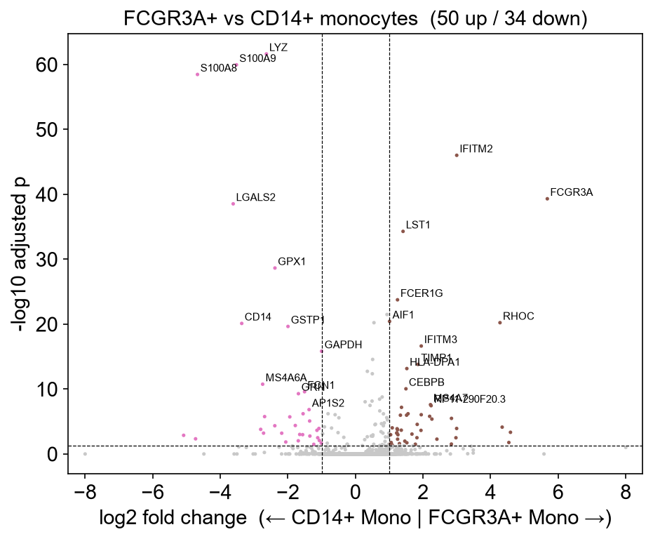

| 방향 | 대표 유전자 (log2FC) |
|---|---|
| FCGR3A+ ↑ (50개) | FCGR3A (5.7), RHOC (4.3), IFITM2 (3.0), IFITM1 (2.8), ABI3 (2.3), MS4A7 (2.2), LRRC25 (2.2), IFITM3 (1.9), TIMP1 (1.9), HLA-DPA1 (1.5), CEBPB (1.5) |
| CD14+ ↑ (34개) | S100A8 (−4.7), LGALS2 (−3.6), S100A9 (−3.5), CD14 (−3.4), VCAN (−2.8), CSF3R (−2.7), MS4A6A (−2.7), LYZ (−2.6), GPX1 (−2.4), FCN1 (−1.5) |

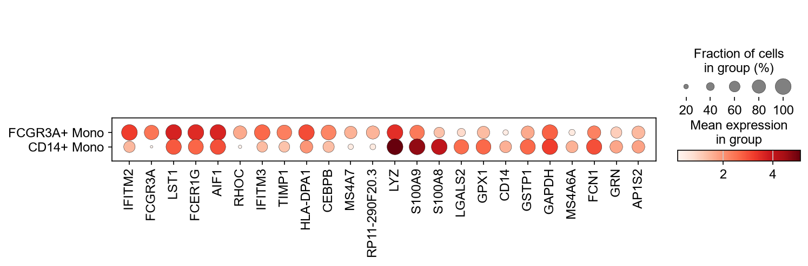

### 4-3. 경로분석

- **ORA** (GO Biological Process): 유의한 DE 유전자 목록이 gene set과 우연보다 많이 겹치는지 Fisher 검정.
  배경은 사람 전체 유전자가 아니라 **실제로 검정한 1,578개**로 줬다. 전체를 배경으로 쓰면 단핵구에서 발현된다는 이유만으로 면역 term이 모두 유의해진다.
- **GSEA prerank** (MSigDB Hallmark): 컷오프 없이 전체 유전자 순위(Wilcoxon 통계량)에서 gene set이 한쪽 끝에 몰리는지 본다.

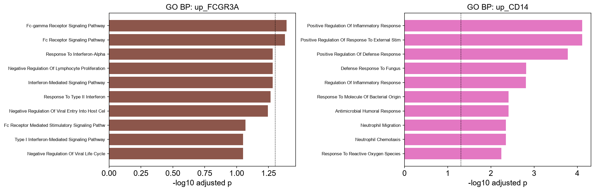

| 집단 | 유의 term 수 (padj < 0.05) | 상위 term | 겹친 유전자 |
|---|---|---|---|
| CD14+ ↑ | 21 | Positive regulation of inflammatory response | S100A8, S100A9, S100A12, LGALS2, GRN, NFKBIA, CCL3 |
| | | Neutrophil chemotaxis / migration | S100A8, S100A9, S100A12, CCL3 |
| | | Antimicrobial humoral response, Response to molecule of bacterial origin | LYZ, S100A9, S100A12, CD14 |
| FCGR3A+ ↑ | 2 | Fc-gamma receptor signaling pathway | FCGR3A, FCER1G, LYN, HCK |
| | | (padj 0.05~0.09) Response to interferon-alpha, interferon-mediated signaling | IFITM1, IFITM2, IFITM3 |

GSEA Hallmark에서는 **Interferon Alpha Response**가 FCGR3A+ 쪽으로 가장 강하게 치우쳤다(NES +1.95, FDR < 0.001; IFITM1/2/3, LY6E, ISG15, PSMB9, OAS1).
그다음은 Apical Junction(NES +1.77, FDR 0.025)인데 leading-edge 유전자가 ACTB, PFN1, ARPC2, VASP, RAC2 등 actin 세포골격 유전자다.

### 4-4. 생물학적 해석

**CD14+ classical 단핵구 = 세균 감지와 급성 염증의 1차 대응자.**
CD14는 TLR4와 함께 세균 LPS를 인식하는 공수용체다. S100A8/A9(calprotectin)과 S100A12는 염증 부위에서 분비되는 alarmin으로 호중구를 끌어들이고,
LYZ(lysozyme)는 세균 세포벽을 분해한다. VCAN, CSF3R, FCN1도 classical 단핵구의 알려진 특징이다. GO 결과(염증 반응 촉진, 호중구 주화성, 항균 반응)가 이 기능과 맞아떨어진다.

**FCGR3A+ non-classical 단핵구 = 혈관을 순찰하며 항체·바이러스 신호에 반응.**
- FCGR3A(CD16)와 그 신호전달 사슬 FCER1G, Src 계열 kinase LYN·HCK가 함께 올라가 Fcγ 수용체 신호 경로가 enrichment된다 → 항체로 덮인 표적을 인식하는 기능.
- IFITM1/2/3, ISG15 등 interferon 유도 유전자가 높다 → 항바이러스 상태.
- RHOC, ABI3, VASP와 actin 조절 유전자가 높다. non-classical 단핵구는 혈관 내피를 따라 기어 다니며 감시하는(patrolling) 세포로 알려져 있어 세포 운동성과 연결해 해석할 수 있다.
  다만 Hallmark "Apical Junction"이라는 이름 자체는 상피세포 접합을 뜻하므로, term 이름이 아니라 leading-edge 유전자를 보고 해석해야 한다.
- HLA-DPA1 등 MHC class II가 더 높은 것도 non-classical 쪽이 항원제시 유전자를 더 발현한다는 보고와 일치한다.

**해석 시 주의**
- GSEA에서 FDR < 0.25인 경로가 모두 FCGR3A+ 방향(NES > 0)이다. 4-1의 잔여 깊이 편향이 영향을 줬을 수 있어, Interferon Alpha Response처럼 FDR이 매우 낮고 개별 유전자의 log2FC가 큰 것만 신뢰한다.
- FCGR3A+ ↑ 쪽 GO term은 유전자 3~5개 겹침에 padj 0.04~0.09로 근거가 약하다. IFITM1/2/3 세 유전자가 여러 term에 반복 등장하는 것이므로 "독립적인 여러 경로"로 세면 안 된다.
- 단일 공여자 결과라 개인차와 세포타입 차이를 분리할 수 없다.

### 산출물

- `results/de_fcgr3a_vs_cd14_mono.csv` (깊이 맞춤, 본 결과), `results/de_mono_naive_depth_biased.csv` (보정 전, 비교용)
- `results/enrich_GO_BP_up_FCGR3A.csv`, `results/enrich_GO_BP_up_CD14.csv`, `results/gsea_hallmark.csv`
- `figures/14~17_*.png`
