# 작업 2 — 공간전사체 분석 (10x Visium, 성체 마우스 뇌)

마우스 뇌 coronal 절편의 Visium 데이터를 Scanpy + Squidpy로 분석해
공간 도메인(조직 구조)을 찾고, 공간 변이 유전자를 탐색하고, 조직학적으로 해석한다.

- 데이터: 10x Genomics 공개 데모 `V1_Adult_Mouse_Brain` (fresh frozen, H&E, Space Ranger 1.1.0). `sq.datasets.visium()`으로 자동 다운로드
- 환경: Python 3.12, scanpy 1.12, squidpy 1.8

| 단계 | 스크립트 | 상태 |
|---|---|---|
| 1. 로드 + QC | `step1_load_qc.py` | 완료 |
| 2. 클러스터링 → 공간 도메인 | `step2_spatial_domains.py` | 완료 |
| 3. 공간 변이 유전자 (Moran's I) | `step3_spatially_variable_genes.py` | 완료 |
| 4. Deconvolution (NNLS) | `step4_deconvolution.py` | 완료 |

---

## 1단계. 데이터 로드 + QC

### 1-1. Visium 데이터의 구조

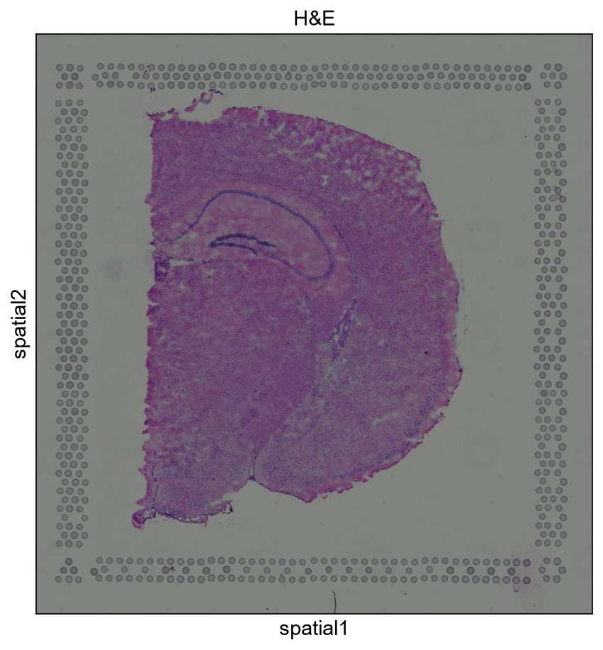

| 항목 | 값 |
|---|---|
| 조직 아래 spot | 2,702개 (슬라이드 전체 4,992개 중) |
| 유전자 | 32,285개 (mm10) |
| spot 지름 / 중심 간격 | 55 µm / 100 µm (육각 격자) |
| 이미지 해상도 | 원본 1픽셀 ≈ 0.61 µm |

scRNA-seq과의 차이가 이후 모든 해석의 전제다.

- **관측 단위가 세포가 아니라 spot이다.** 한 spot에 대략 1~10개 세포가 들어가므로 발현값은 여러 세포(종종 여러 세포타입)의 합이다.
- **위치가 보존된다.** 조직을 해리하지 않으므로 각 spot이 슬라이드 좌표를 갖고, H&E 이미지와 같은 좌표계에 놓인다.
- AnnData에서 `obsm["spatial"]`이 픽셀 좌표, `uns["spatial"]`이 이미지와 scale factor를 담는다.

H&E에서 절편은 한쪽 반구의 coronal 단면이고, 위쪽·오른쪽 바깥이 대뇌피질, 가운데 위의 진한 보라색 곡선이 해마(바깥 호 = CA 영역 피라미드 세포층, 안쪽 V자 = 치아이랑)다.
헤마톡실린은 핵을 보라색으로 염색하므로 진한 띠는 세포체가 빽빽한 곳이다.

### 1-2. QC 지표와 공간 분포

| 지표 | 1% | 중앙값 | 99% | 최대 |
|---|---|---|---|---|
| 총 UMI / spot | 8,188 | 28,944 | 84,329 | 156,413 |
| 검출 유전자 수 / spot | 2,406 | 6,019 | 9,324 | 10,934 |
| 미토콘드리아 비율 (%) | 8.4 | 15.3 | 28.0 | 43.2 |
| 헤모글로빈 비율 (%) | 0.1 | 0.2 | 8.2 | 26.4 |

PBMC3k(세포당 UMI 중앙값 2,197, 유전자 817개)보다 한 자릿수 많다. spot 하나가 여러 세포의 합이고 Visium의 포획 면적이 넓기 때문이다.

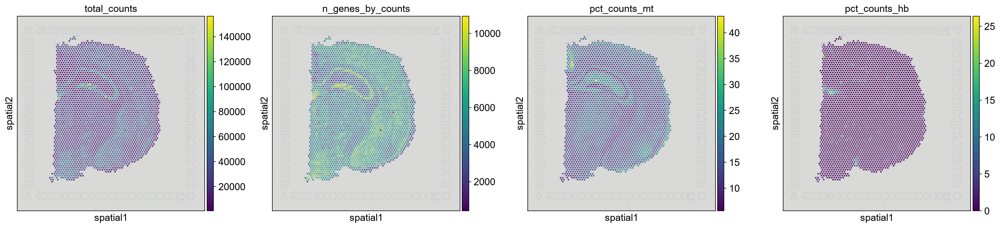

**QC 지표가 무작위가 아니라 해부학 구조를 따라간다.**
- 총 UMI와 유전자 수는 해마의 피라미드 세포층·치아이랑을 따라 가장 높다. H&E에서 핵이 가장 빽빽한 띠와 일치한다 → 세포 밀도를 반영한다.
- 미토콘드리아 비율이 중앙값 15%로 PBMC(2%)보다 훨씬 높다. 뉴런은 에너지 소비가 커서 미토콘드리아가 많고, 조직 절편에서는 세포 단위로 손상 세포를 걸러내는 과정이 없기 때문이다.
  scRNA-seq의 "5%" 기준을 그대로 쓰면 spot이 한 개도 남지 않는다(최솟값 5.6%).
- 헤모글로빈은 대부분 0.2% 안팎이고 몇몇 spot만 높다 → 혈관이나 국소 출혈 부위.

### 1-3. 필터링

| 기준 | 값 | 근거 |
|---|---|---|
| 총 UMI | ≥ 5,000 | 1% 분위(8,188)보다 아래. 분포의 꼬리에서 떨어진 극단값만 제거 |
| 미토콘드리아 비율 | ≤ 30% | 99% 분위(28.0%) 바로 위 |
| 유전자 검출 spot 수 | ≥ 10 | |

| 판정 | spot 수 |
|---|---|
| 통과 | **2,683** |
| 미토콘드리아 비율 과다 | 10 |
| UMI 부족 | 8 |
| 둘 다 | 1 |

spot 2,702 → 2,683 (19개, 0.7% 제거), 유전자 32,285 → 17,535.

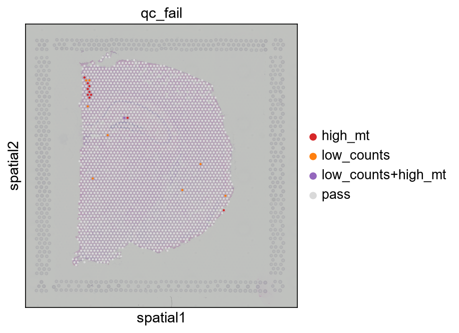

**제거된 spot의 위치를 확인했다.** 미토콘드리아 비율이 높은 spot 10개 중 8개가 조직 왼쪽 위 가장자리(절단면)에 줄지어 있다.
특정 해부학 구조 안쪽이 아니라 절편의 가장자리이므로 절단·건조에 의한 손상으로 판단했다. UMI가 부족한 spot은 조직 전체에 한두 개씩 흩어져 있다.

> **공간 데이터 QC의 원칙**: 낮은 UMI가 곧 저품질은 아니다. 백질이나 뇌실 주변처럼 세포가 적은 곳은 원래 RNA가 적다.
> 임계값을 엄격하게 잡으면 특정 구조가 통째로 사라지므로, 지표를 조직 위에 그려 본 뒤 극단값만 보수적으로 제거했다.
> spot을 지우면 격자에 구멍이 생겨 이후 공간 이웃 분석에 영향을 주기 때문에도 최소한으로 한다.

### 산출물

- `data/visium_step1_qc.h5ad` — 2,683 spots × 17,535 genes (X·layers["counts"]: raw count)
- `figures/01~04_*.png`

---

## 2단계. 클러스터링으로 공간 도메인 식별

### 2-1. 접근: 좌표 없이 클러스터링하고, 조직 위에서 검증한다

```
raw count → CP10K + log1p → HVG 2,000개 → scale → PCA(50) → 상위 30 PC → kNN(k=15) → Leiden   ← 여기까지 좌표 미사용
                                                                                   ↓
                                                              조직 좌표에 다시 그려 해부학 구조와 대조
```

클러스터링 절차는 scRNA-seq과 같고 spot의 위치는 전혀 쓰지 않았다.
그런데도 클러스터가 조직 위에서 연속된 구역으로 나타난다면, 그것이 클러스터가 실제 조직 구조를 반영한다는 **독립적인 검증**이 된다.

scRNA-seq의 클러스터는 세포타입이지만, Visium의 클러스터는 **세포 조성이 비슷한 조직 구역(도메인)** 이다. spot 하나가 여러 세포의 합이기 때문이다.

HVG 상위에는 Ttr(맥락총), Pmch·Hcrt(시상하부 신경펩타이드), Hpca, Npy 등 특정 구조에 국한된 유전자가 올라왔다.

### 2-2. PCA: 주성분이 곧 해부학적 축

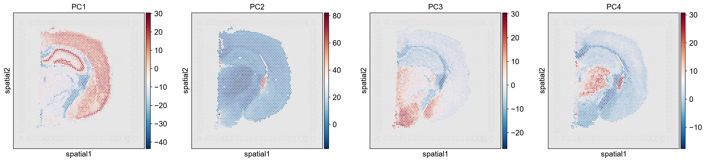

PC 점수를 조직 위에 그리면 각 PC가 뇌의 큰 구획을 나눈다. PC1–10이 분산의 30.7%를 설명하는데 PBMC3k(6.8%)보다 훨씬 높다.
spot이 여러 세포의 합이라 dropout 노이즈가 평균되어 줄고, 뇌 영역 간 발현 차이가 크기 때문이다.

### 2-3. 클러스터의 공간 응집도

| resolution | 0.4 | 0.6 | **0.8** | 1.0 | 1.2 |
|---|---|---|---|---|---|
| 클러스터 수 | 13 | 17 | **19** | 21 | 25 |

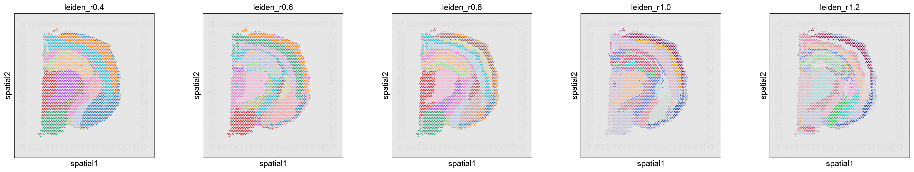

0.8을 채택했다. 피질 층과 해마 CA1이 각각 분리되고, 19개 클러스터 모두를 알려진 구조에 대응시킬 수 있었다(2-4).

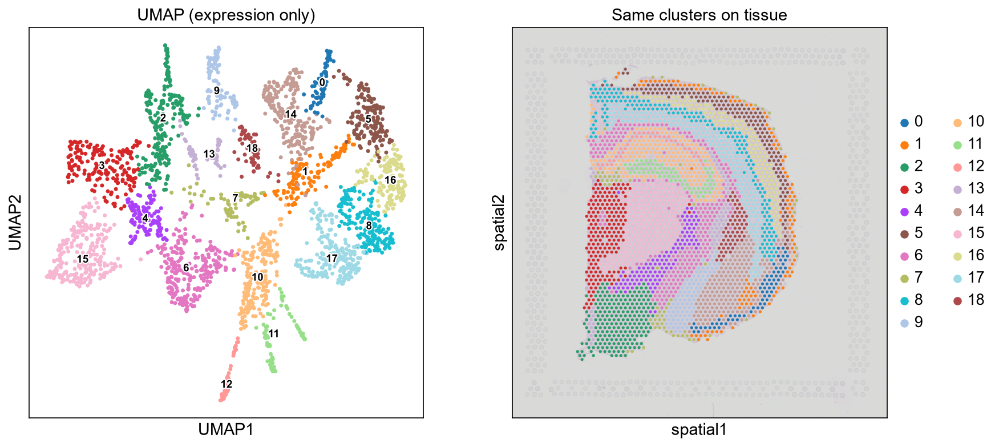

**정량 검증**: 물리적으로 인접한 spot 쌍(육각 격자, spot당 평균 5.78개 이웃) 중 같은 클러스터에 속하는 비율을 계산했다.

| | 인접 spot이 같은 클러스터인 비율 |
|---|---|
| 관측 | **0.724** |
| 클러스터 라벨을 무작위로 섞었을 때 (200회) | 평균 0.064, 최대 0.071 |

좌표를 쓰지 않고 만든 클러스터인데 인접 spot의 72%가 같은 클러스터다. 무작위 기대의 11배다.
클러스터별로는 시상하부(0.90), 외측 시상(0.88)처럼 덩어리진 구조가 높고, 수막(0.44), CA1(0.48), 피질 L1(0.49)처럼 폭이 spot 1~2개인 얇은 구조가 낮다.
얇은 띠는 이웃의 대부분이 다른 구조일 수밖에 없으므로 낮은 값이 품질 문제를 뜻하지는 않는다.

### 2-4. 도메인 annotation

근거는 두 가지다. (1) 조직 위에서의 **위치와 모양**을 H&E 및 마우스 뇌 지도(coronal)와 대조, (2) **마커 유전자**.

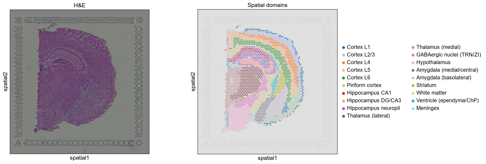
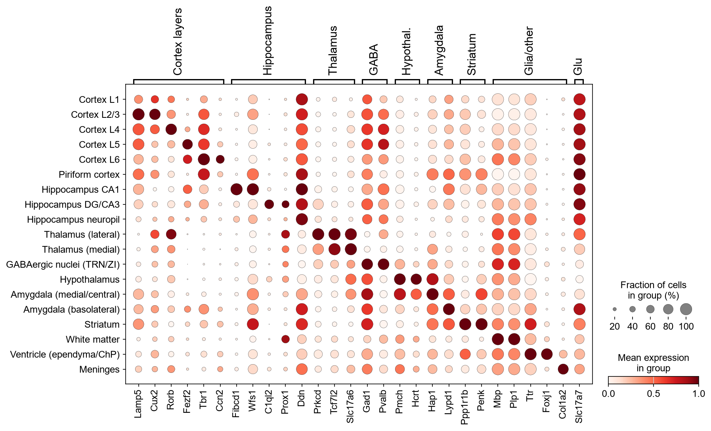

| 도메인 | spot 수 | 위치·모양 | 마커 유전자 | 확신도 |
|---|---|---|---|---|
| Cortex L1 | 117 | 피질 가장 바깥의 얇은 띠 | Slc1a2, Slc1a3 (astrocyte), 뉴런 마커 낮음 | 중 |
| Cortex L2/3 | 158 | 바깥에서 두 번째 호 | Lamp5, Cux2, Calb1, Rasgrf2 | 상 |
| Cortex L4 | 143 | L2/3와 L5 사이 | Rorb (피질 중 최고), Mef2c, Nrgn | 상 |
| Cortex L5 | 185 | L4 안쪽 | Fezf2, Bcl11b, Pvalb | 상 |
| Cortex L6 | 203 | 백질 바로 바깥 | Tbr1, Ccn2 (Ctgf), Nr4a2 | 상 |
| Piriform cortex | 67 | 복외측 가장자리의 호 | Slc17a7, Slc30a3, Nptxr, Tafa1 | 중 |
| Hippocampus CA1 | 42 | 해마 바깥쪽 얇은 호 | Fibcd1, Wfs1, Spink8, Lefty1 | 상 |
| Hippocampus DG/CA3 | 72 | 해마 안쪽 띠 | C1ql2, Prox1, Dsp (치아이랑), Bok (CA3) | 상 |
| Hippocampus neuropil | 194 | 세포체층 사이를 채움 | Camk2a, Ddn, Shank1, Cabp7 | 상 |
| Thalamus (lateral) | 251 | 중앙의 큰 덩어리 | Prkcd, Rora, Tnnt1, Slc17a6 | 상 |
| Thalamus (medial) | 188 | 정중선 쪽 | Tcf7l2, Slc17a6, Calb2, Cbln1/2/4 | 상 |
| GABAergic nuclei (TRN/ZI) | 114 | 시상 아래·바깥을 감싸는 띠 | Gad1/2, Slc32a1, Pvalb, Syt2 | 중 |
| Hypothalamus | 214 | 복내측 | Pmch, Hcrt, Dlk1, Baiap3, Gpx3 | 상 |
| Amygdala (medial/central) | 92 | 시상하부 외측 | Hap1, Cartpt, Penk, Zcchc12 | 중 |
| Amygdala (basolateral) | 207 | 복외측, 피질 안쪽 | Lypd1, Lmo3, Slc30a3, Slc17a7 | 중 |
| Striatum | 60 | 외측의 작은 구역 | Ppp1r1b, Penk, Gpr88, Adora2a | 상 |
| White matter | 248 | 피질 아래 호 + 내부 섬유다발 | Mbp, Plp1, Mobp, Mag, Cldn11 | 상 |
| Ventricle (ependyma/ChP) | 56 | 가는 선, 정중선과 외측 | Ttr, Foxj1, Rsph1, Calml4 (섬모) | 상 |
| Meninges | 72 | 조직 표면에 흩어짐 | Col1a2, Dcn, Mgp, Slc6a13, Ptgds | 상 |

### 2-5. 조직학적·생물학적 해석

**대뇌피질의 층 구조가 발현만으로 재현된다.** 피질 클러스터 5개가 바깥에서 안쪽으로 L1 → L2/3 → L4 → L5 → L6 순서의 동심 호로 배열된다.
마커도 순서대로 넘어간다(dotplot의 대각선): Lamp5·Cux2 → Rorb → Fezf2 → Tbr1·Ccn2.
층마다 투사 대상이 다른 뉴런이 모여 있기 때문이다. L2/3는 피질 내 연결, L4는 시상 입력을 받는 층(Rorb), L5는 피질하 구조로 내려가는 투사(Fezf2), L6는 시상으로 되돌아가는 투사(Tbr1)를 담당한다.

**해마는 세포체층과 신경망층이 따로 잡힌다.** H&E에서 진한 보라색 띠였던 곳이 CA1(Fibcd1, Wfs1)과 DG/CA3(C1ql2, Prox1)로 나뉘고, 그 사이의 옅은 부분이 별도의 "neuropil" 도메인이 된다.
neuropil 도메인의 마커 Camk2a, Ddn(dendrin), Shank1은 수상돌기로 운반되어 시냅스 근처에서 번역되는 mRNA로 알려져 있다.
즉 이 도메인은 다른 세포타입이 아니라 **같은 피라미드 뉴런의 다른 부위**(세포체가 아닌 수상돌기)를 보고 있는 것이다. 세포를 해리하는 scRNA-seq에서는 볼 수 없는 정보다.

**시상과 시상하부는 신경전달물질·신경펩타이드로 구분된다.** 시상은 Slc17a6(VGLUT2) 글루탐산성이고 피질은 Slc17a7(VGLUT1)이다.
시상하부는 Pmch(MCH)·Hcrt(orexin) 같은 신경펩타이드가 특징인데, 둘 다 외측 시상하부에서 섭식·각성을 조절하는 뉴런의 마커다.

**백질은 oligodendrocyte 유전자로 정의된다.** Mbp, Plp1, Mobp, Mag는 수초 구성 단백질이다. 뇌량에서 이어지는 피질 아래의 호와 내부 섬유다발이 함께 묶였다.
1단계에서 "UMI가 적다고 자르면 안 된다"고 했던 구조가 바로 이런 곳이다.

**비뉴런 구조도 잡힌다.** 뇌실 도메인은 Ttr(맥락총 상피가 분비하는 transthyretin)와 Foxj1·섬모 유전자(뇌실막세포)가, 수막은 섬유아세포 유전자(Col1a2, Dcn)가 특징이다.

### 2-6. 한계

- **경계 spot은 혼합이다.** 지름 55 µm spot이 두 구조에 걸치면 중간 프로파일이 되어 어느 한쪽에 배정된다. 얇은 구조(L1, CA1, 뇌실)의 경계는 spot 한 개 수준의 오차가 있다.
- **확신도 "중"인 도메인**: 편도체 두 구역, 조롱박피질, GABAergic nuclei는 마커가 인접 구조와 겹치고(예: Hap1·Baiap3는 시상하부와 내측 편도체 공통) 뇌 지도와 정밀 정합을 하지 않아 대략적인 이름이다.
  GABAergic nuclei는 Pvalb+ GABA성 뉴런과 수초 유전자가 함께 높아 시상그물핵/불확정대로 추정했으나 창백핵 일부가 포함됐을 수 있다.
  L1은 고유 마커가 약하고 수막·L2/3와 섞인다.
- **줄무늬체의 Ttr**: Striatum 도메인에서 Ttr이 높게 나온다. 줄무늬체 세포가 발현한다기보다 바로 옆 외측 뇌실 맥락총에서 나온 초고발현 전사체가 인접 spot으로 번진 것(lateral diffusion)으로 보인다. Visium에서 알려진 현상이다.
- **절편 1장**이다. 반복 절편이나 다른 개체가 없어 도메인의 재현성은 확인하지 못했다.
- 좌표를 함께 쓰는 공간 인지 클러스터링(BayesSpace, SpaGCN, GraphST 등)은 경계를 더 매끄럽게 만들지만, 이번에는 "좌표 없이도 구조가 나온다"는 검증을 위해 쓰지 않았다.

### 산출물

- `data/visium_step2_domains.h5ad` — `obs["cluster"]`, `obs["domain"]`, `obsp["spatial_connectivities"]`
- `results/cluster_markers_top25.csv`, `results/cluster_spatial_coherence.csv`, `results/domain_summary.csv`
- `figures/05~13_*.png`

---

## 3단계. 공간 변이 유전자 (SVG) 탐색

### 3-1. SVG와 Moran's I

**SVG**는 발현이 조직 위에서 무작위가 아니라 공간적 패턴을 이루는 유전자다.
HVG는 spot 간 변동이 큰지만 보고 위치는 보지 않는다. SVG는 **가까운 spot끼리 값이 비슷한지**를 본다.

**Moran's I**는 공간 자기상관 통계량으로, 직관적으로는 "이웃한 spot 쌍의 발현 상관계수"다.

```
I = (N / W) · Σ w_ij (x_i − x̄)(x_j − x̄) / Σ (x_i − x̄)²        w_ij = spot i, j가 인접하면 1
```

| I 값 | 의미 |
|---|---|
| +1에 가까움 | 이웃끼리 비슷하다 (뭉친 패턴) |
| 0 근처 | 공간적으로 무작위 |
| 음수 | 이웃끼리 반대 (체스판 무늬) |

이웃 관계는 2단계에서 만든 육각 격자 그래프를 썼다. 유의성은 spot 위치를 무작위로 섞는 순열 검정(100회)으로 평가했다.

### 3-2. 결과

- 검정 대상: spot의 5% 이상에서 검출된 **12,887개** 유전자 (미토콘드리아·리보솜 제외)
- 순열 검정 FDR < 0.05: 9,842개 (76%)
- **I ≥ 0.3: 1,070개** (8.3%) — 이후 "뚜렷한 SVG"로 다룸
- I 분포: 중앙값 0.045, 상위 10% 0.263, 상위 1% 0.611, 최대 0.893

> **유의성 기준만으로는 SVG를 고를 수 없다.** 유전자의 76%가 유의하다. 뇌처럼 구조가 뚜렷한 조직에서는 대부분의 유전자가 약하게라도 공간 패턴을 가지고,
> spot이 2,683개라 약한 자기상관도 검출되기 때문이다. 또 순열 100회의 최소 p값은 1/101 ≈ 0.0099여서 상위 유전자끼리는 p값이 모두 같다.
> 그래서 순위와 선별은 효과크기인 I 값으로 했다. 0.3은 분포를 보고 정한 임의의 기준이다.

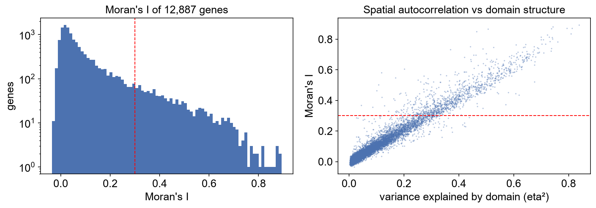
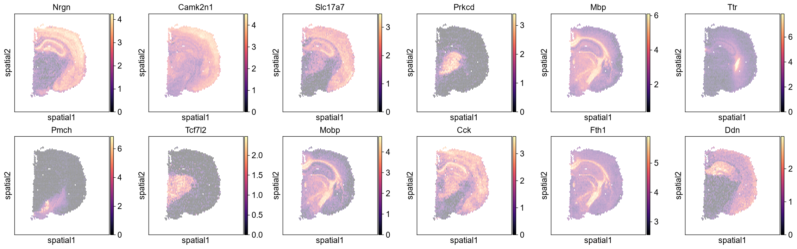

**상위 SVG와 그 패턴**

| 유전자 | I | 가장 높은 도메인 | 기능 |
|---|---|---|---|
| Nrgn | 0.893 | 해마 CA1 | neurogranin, 흥분성 뉴런의 시냅스 후 단백질 |
| Camk2n1 | 0.882 | 피질 L2/3 | CaMKII 억제 단백질 |
| Slc17a7 | 0.872 | 조롱박피질 (피질·해마 전반) | VGLUT1, 종뇌 글루탐산성 뉴런 |
| Prkcd | 0.872 | 외측 시상 | PKCδ, 시상 중계핵 마커 |
| Mbp | 0.871 | 백질 | myelin basic protein |
| Ttr | 0.867 | 뇌실 | transthyretin, 맥락총 |
| Pmch | 0.850 | 시상하부 | MCH 신경펩타이드 |
| Tcf7l2 | 0.835 | 시상 | 시상 발생·유지 전사인자 |

상위 유전자는 2단계에서 도메인 마커로 쓴 것과 대부분 겹친다. 클러스터 정보를 전혀 쓰지 않는 방법으로 같은 유전자가 나왔으므로 도메인 해석을 독립적으로 뒷받침한다.

### 3-3. SVG와 HVG는 같지 않다

상위 500개 SVG와 상위 500개 HVG의 겹침은 **194개**(39%)뿐이다.

**HVG인데 공간 패턴이 없는 유전자** (I ≤ 0.1): S100a8, Ccl5, Lyz2, Lrg1, Thbd, Fn1 등

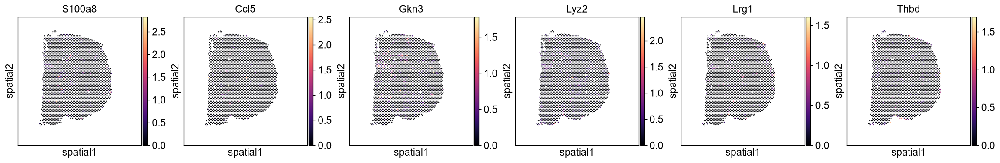

극소수 spot에서만 켜지고 위치가 흩어져 있다. S100a8·Lyz2(골수계 세포), Ccl5(림프구), Thbd·Fn1(혈관)처럼 혈관 안이나 주변에 드물게 있는 세포에서 온 신호로 보인다.
몇 개 spot에서만 높으니 분산은 크지만(HVG), 뇌 구조를 따라가지 않으므로 SVG는 아니다.

**HVG가 아닌데 SVG인 유전자** (I ≥ 0.3, 339개): Camk2a (0.78), Calm1 (0.71), Stmn1 (0.64), Syt1 (0.61), Vamp2 (0.58) 등

거의 모든 spot에서 발현되는 뉴런 공통 유전자다. 평균 대비 분산이 특별히 크지 않아 HVG에서 빠졌지만, 넓은 영역에 걸쳐 완만하게 변하는 패턴이 있어 I가 높다.
HVG만으로 분석하면 이런 넓은 영역의 패턴을 놓친다.

### 3-4. 도메인 경계보다 세밀한 패턴

각 유전자의 분산을 도메인이 얼마나 설명하는지(η²)를 함께 계산했다.

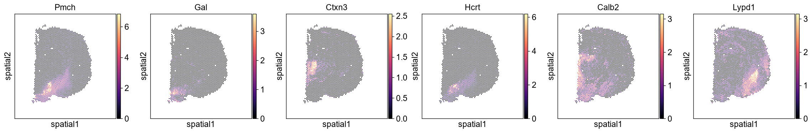

I는 높은데 η²가 낮은 유전자는 **도메인보다 작은 단위의 구조**를 보여준다.

| 유전자 | I | η² | 패턴 |
|---|---|---|---|
| Pmch | 0.85 | 0.47 | 시상하부 도메인의 외측 일부에 집중 |
| Hcrt | 0.73 | 0.37 | Pmch와 비슷한 위치의 더 좁은 구역 |
| Gal | 0.75 | 0.44 | 시상하부의 복내측 구석 |
| Trh | 0.61 | 0.20 | 시상하부 내 소수 spot |
| Ctxn3, Calb2 | 0.74, 0.70 | 0.49, 0.45 | 내측 시상 안의 일부 구역 |
| Lypd1 | 0.70 | 0.46 | 기저외측 편도체 중심부에서 최고 |

**생물학적 의미**: 시상하부는 2단계에서 하나의 도메인으로 묶였지만 실제로는 기능이 다른 여러 핵의 집합이다.
Pmch(MCH)와 Hcrt(orexin)는 외측 시상하부에 있는 별개의 뉴런 집단으로 각각 수면·섭식과 각성 조절에 관여하고,
Gal(galanin)과 Trh(TRH)는 또 다른 핵에 있다. 신경펩타이드 유전자는 소수 뉴런에서 매우 강하게 발현되어 좁은 구역에 집중된다.
클러스터링이 하나로 묶은 구역 안에 유전자 수준에서는 더 세밀한 지도가 있다는 것이 SVG 분석이 클러스터링에 더해 주는 정보다.

### 3-5. 한계

- **Moran's I는 패턴의 "모양"을 구분하지 못한다.** 한 덩어리로 뭉친 패턴이든 층 모양이든 I가 같을 수 있다. 패턴 유형별로 묶으려면 SVG끼리 공간 발현을 군집화하는 추가 분석이 필요하다.
- **이웃을 인접 한 겹(100 µm)으로만 정의했다.** 이보다 큰 규모의 구배에는 덜 민감하다. SpatialDE, SPARK-X, nnSVG 같은 방법은 여러 길이 척도를 모델링한다.
- **발현량이 높은 유전자가 유리하다.** 저발현 유전자는 dropout 노이즈로 이웃 간 상관이 희석되어 I가 낮게 나온다. 상위 목록이 고발현 유전자에 치우쳐 있다.
- **세포 조성과 세포 내 발현 변화를 구분하지 못한다.** Mbp가 백질에서 높은 것은 oligodendrocyte가 많아서지 세포당 발현이 올라서가 아니다. 대부분의 SVG는 조성 차이를 반영한다. 이를 분리하려면 4단계의 deconvolution이 필요하다.
- I ≥ 0.3과 η² < 0.5는 탐색을 위한 임의의 기준이다(I ≥ 0.3인 1,070개 중 827개가 η² < 0.5). 절편 1장이라 재현성은 확인하지 못했다.

### 산출물

- `results/svg_moran_all.csv` — 12,887개 유전자의 I, p값, HVG 여부, 최고 발현 도메인, η²
- `results/svg_by_peak_domain.csv`
- `figures/14~17_*.png`

---

## 4단계. Deconvolution — spot별 세포타입 조성 추정

### 4-1. 목적과 방법

spot 하나에는 여러 세포가 들어 있어 발현값이 세포타입들의 합이다. 3단계의 한계(조성 차이와 세포 내 발현 변화를 구분하지 못함)를 풀려면
spot을 세포타입 비율로 분해해야 한다.

- **레퍼런스**: squidpy 내장 마우스 피질 scRNA-seq (`sq.datasets.sc_mouse_cortex`, 21,697 cells, SMART-seq, Allen Institute 세포타입 라벨).
  세포 50개 이상인 21개 타입 사용 (흥분성 뉴런 8종, 억제성 뉴런 7종, 비뉴런 6종)
- **방법**: 비음수 최소제곱(NNLS). spot의 발현 벡터 y를 세포타입별 평균 프로파일 S의 가중합으로 설명한다.

```
y ≈ S · w   (w ≥ 0)   →   w를 합이 1이 되도록 나눈 값 = 세포타입 비율
```

| 설계 | 선택 | 이유 |
|---|---|---|
| 유전자 | 세포타입당 마커 60개의 합집합 957개 | 모든 타입에서 비슷한 유전자는 분해에 정보를 주지 않고 노이즈만 더한다 |
| 스케일 | log가 아닌 선형(CP10K) | mRNA 혼합은 선형 공간에서 더해진다 |
| 유전자별 크기 보정 | 각 유전자를 signature 최댓값으로 나눔 | 보정하지 않으면 고발현 유전자 몇 개의 오차만 줄이는 해가 나온다 |
| 제약 | w ≥ 0 | 세포 비율은 음수일 수 없다 |

cell2location, RCTD 같은 전용 도구는 count 노이즈와 플랫폼 차이를 확률 모델로 다룬다. 여기서는 원리가 드러나고 검증하기 쉬운 NNLS를 직접 구현했다.

### 4-2. 검증 1 — 정답을 아는 가상 spot

레퍼런스 세포의 30%(6,487개)를 떼어 두고, 2~4개 타입에서 세포 8개를 뽑아 raw count를 합친 가상 spot 1,000개를 만들었다.
signature는 나머지 70%로만 만들었다(같은 세포로 만들고 평가하면 정확도가 과대평가된다).

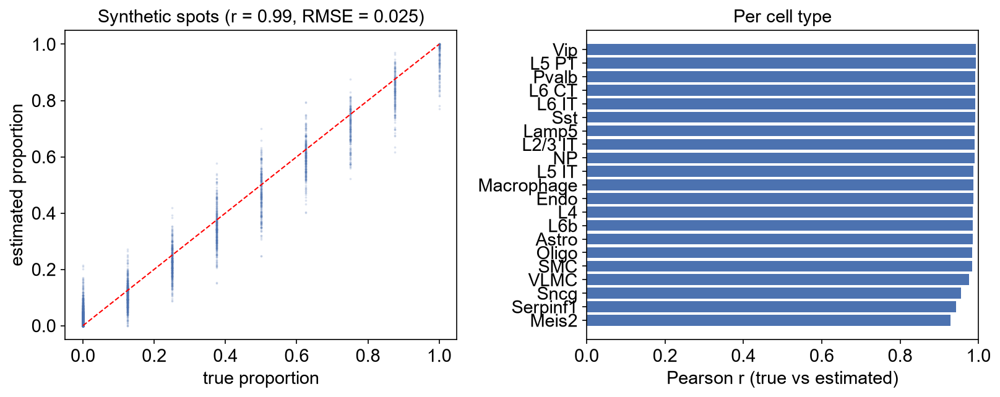

| 지표 | 값 |
|---|---|
| 참값 vs 추정 비율 Pearson r | **0.989** |
| RMSE | 0.025 |
| 세포타입별 r | 0.93 ~ 0.99 |
| 적합도 R² 중앙값 | 0.88 |

r이 낮은 타입은 Meis2(0.93), Serpinf1(0.94), Sncg(0.96)로, 레퍼런스 세포 수가 가장 적은 타입들이다(55~244개).
같은 플랫폼 안에서는 방법이 정확하게 동작한다는 것을 확인했다.

### 4-3. 검증 2 — 피질 층 구조와의 일치

2단계 도메인은 발현 클러스터링으로, 4단계 조성은 외부 레퍼런스로 구했다. 서로 독립적인 두 결과가 맞는지 비교했다.

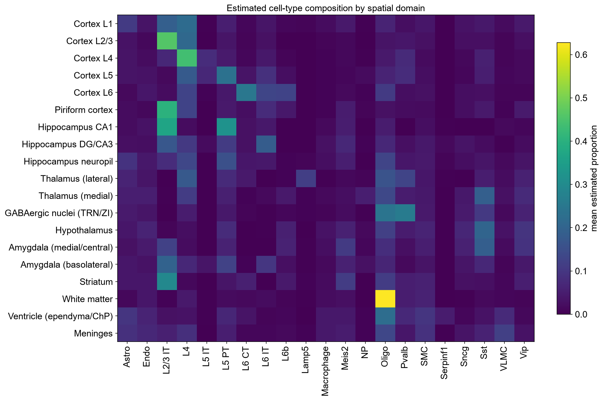

| 도메인 | 비율 1위 세포타입 | 2위 |
|---|---|---|
| Cortex L2/3 | **L2/3 IT** 0.46 | L4 0.21 |
| Cortex L4 | **L4** 0.44 | L5 IT 0.08 |
| Cortex L5 | **L5 PT** 0.23 | L4 0.18 |
| Cortex L6 | **L6 CT** 0.25 | L6 IT 0.13, L6b 0.13 |
| White matter | **Oligo** 0.63 | SMC 0.06 |
| GABAergic nuclei (TRN/ZI) | **Pvalb** 0.26 | Oligo 0.24 |

- 피질 네 층 모두 해당 층의 흥분성 뉴런이 1위다. 히트맵에서 L2/3 IT → L4 → L5 PT → L6 CT로 이어지는 대각선이 보인다.
- 백질은 oligodendrocyte가 63%다. 3단계에서 Mbp가 백질 SVG로 나온 것이 세포 조성 차이 때문임을 직접 확인한 결과다.
- GABAergic nuclei 도메인에서 Pvalb 뉴런과 oligodendrocyte가 함께 높다. 2단계에서 Pvalb와 수초 유전자가 함께 높아 시상그물핵으로 추정했던 것과 일치한다.

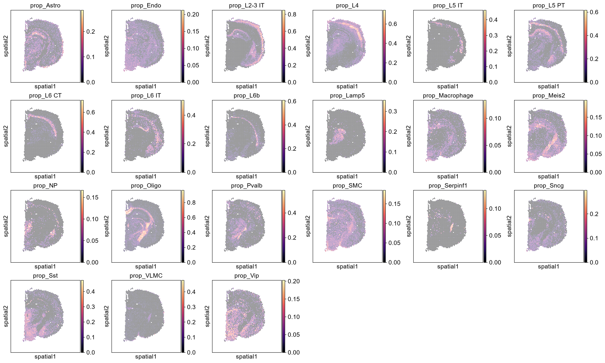

조직 위에서 L2/3 IT, L4, L5 PT, L6 CT, L6b가 바깥에서 안쪽으로 차례로 놓인 호를 이루고, L6b는 백질 바로 바깥의 가장 얇은 띠로 나온다.

### 4-4. 검증 3 — 적합도가 낮은 영역

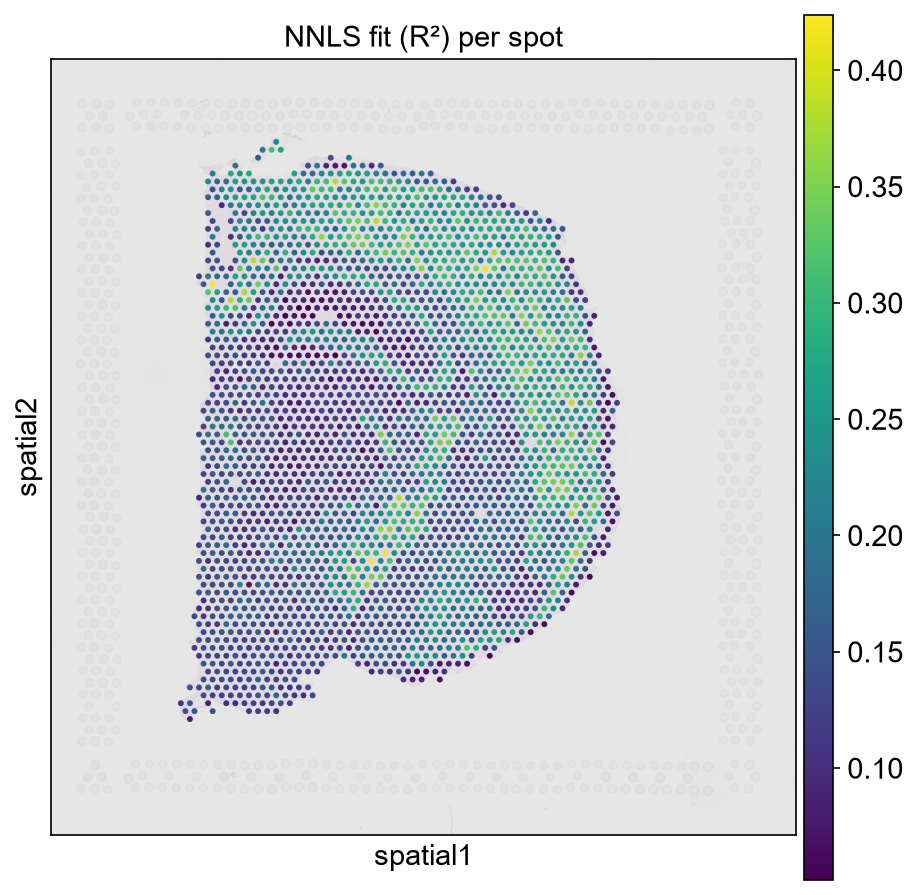

| | 적합도 R² 중앙값 |
|---|---|
| 가상 spot (같은 플랫폼) | 0.88 |
| 실제 Visium 전체 | **0.17** |
| 피질 L2/3 ~ L6 | 0.25 ~ 0.27 |
| 시상, 시상하부, 줄무늬체, 편도체 | 0.12 ~ 0.18 |
| 뇌실, 수막 | 0.12 ~ 0.14 |

실제 데이터의 적합도는 가상 spot보다 크게 낮다. 원인은 두 가지다.

1. **플랫폼 차이.** 레퍼런스는 SMART-seq(전장 전사체, read 수 기반), Visium은 3' 말단 UMI 기반이다. 유전자 길이에 따른 편향과 포획 효율이 달라
   같은 세포타입이라도 유전자별 상대 발현량이 다르다. 레퍼런스가 있는 피질에서도 R²가 0.27에 그치는 이유다.
2. **레퍼런스에 없는 세포타입.** 레퍼런스는 피질 세포만 담고 있다. 시상·시상하부·줄무늬체·편도체의 뉴런, 뇌실막세포, 맥락총 상피는 대응하는 프로파일이 없다.
   NNLS는 가장 비슷한 피질 타입으로 억지로 설명하므로 이 영역의 비율은 **해석하면 안 된다.**

**레퍼런스 밖 영역에서 나온 잘못된 배정의 예**

| 도메인 | 추정 결과 | 실제 |
|---|---|---|
| Hippocampus CA1 | L2/3 IT 0.37 + L5 PT 0.32 | CA1 피라미드 뉴런 (레퍼런스에 없음) |
| Striatum | L2/3 IT 0.29, Meis2 0.11 | 중간가시뉴런 (레퍼런스에 없음) |
| Hypothalamus, 내측 편도체 | Sst 0.19~0.20 | 해당 영역 고유의 GABA성·펩타이드성 뉴런 |
| Ventricle | Oligo 0.22 | 뇌실막세포, 맥락총 상피 |

배정이 틀렸더라도 방향은 설명이 된다. CA1 피라미드 뉴런은 글루탐산성 투사 뉴런이라 피질 흥분성 뉴런에, 시상하부·편도체의 GABA성 뉴런은 피질 억제성 뉴런(Sst)에 가장 가깝게 붙었다.
즉 큰 분류(흥분성/억제성/교세포)는 맞지만 세부 타입 이름은 틀린다.

### 4-5. 해석

- **피질과 백질에서는 결과를 신뢰할 수 있다.** 독립적으로 구한 도메인과 층별 뉴런 조성이 일치하고, 레퍼런스가 해당 영역을 포함한다.
- **spot은 실제로 혼합이다.** 한 spot에서 비율 5% 이상인 세포타입이 중앙값 6개다. 피질 L2/3 도메인도 L2/3 IT가 46%이고 나머지는 인접 층 뉴런, 억제성 뉴런, 교세포다.
  "도메인 = 세포타입"이 아니라 "도메인 = 특정 조성의 구역"이라는 2단계의 전제를 수치로 확인했다.
- **비율은 세포 수가 아니라 mRNA 기여도에 가깝다.** 뉴런은 교세포보다 세포당 mRNA가 많다. astrocyte 비율이 피질 L2/3~L6에서 2~3%로 나왔는데(L1은 11%), 실제 세포 수 비율보다 낮게 추정됐을 가능성이 크다.

### 4-6. 한계

- 적합도 R²가 0.17로 낮다. 비율의 절대값보다 **영역 간 상대 비교와 순위**로만 쓰는 것이 타당하다.
- 레퍼런스가 피질에 한정된다. 전뇌를 다루는 레퍼런스(Allen Brain Cell Atlas 등)를 쓰면 피질하 영역도 해석할 수 있다.
- 플랫폼 차이를 보정하지 않았다. 전용 도구는 유전자별 플랫폼 계수를 함께 추정한다.
- 가상 spot 검증은 레퍼런스 내부에서만 이루어졌으므로 방법의 수학적 정확도를 보여줄 뿐, 실제 Visium에서의 정확도를 보장하지 않는다. 실제 정답(세포 분할 이미지나 단일세포 해상도 공간 데이터)과 비교한 것이 아니다.
- 세포 50개 미만 타입(Peri, CR)은 제외했다.

### 산출물

- `data/visium_step4_deconv.h5ad` — `obsm["deconv_prop"]`, `obs["prop_*"]`, `obs["deconv_r2"]`
- `results/deconv_signature_cp10k.csv`, `deconv_synthetic_validation.csv`, `deconv_mean_proportion_by_domain.csv`, `deconv_fit_r2_by_domain.csv`
- `figures/18~21_*.png`
